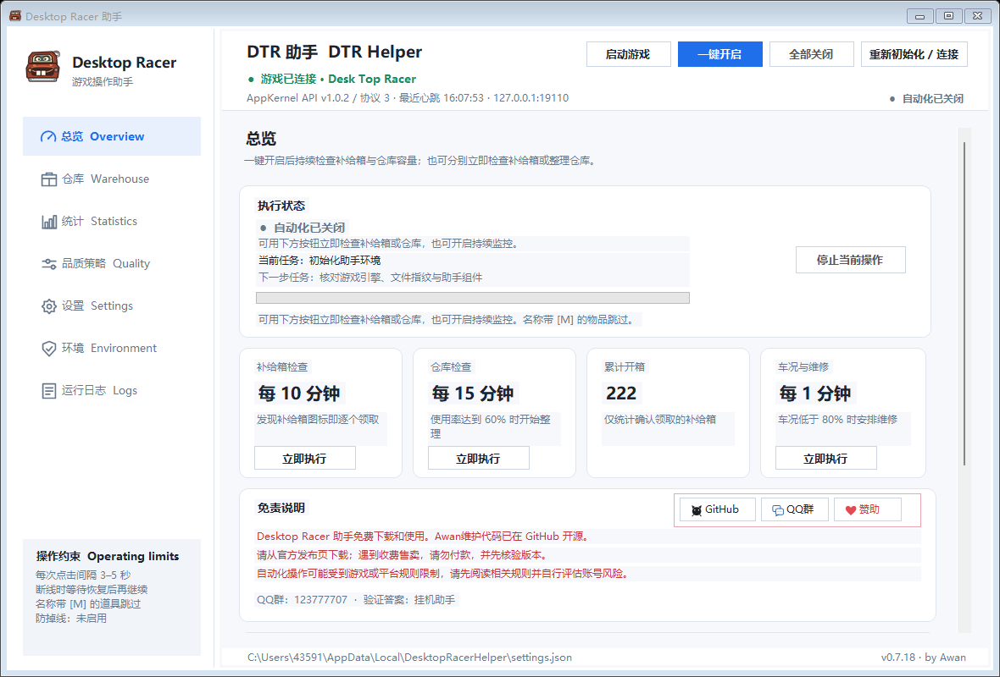
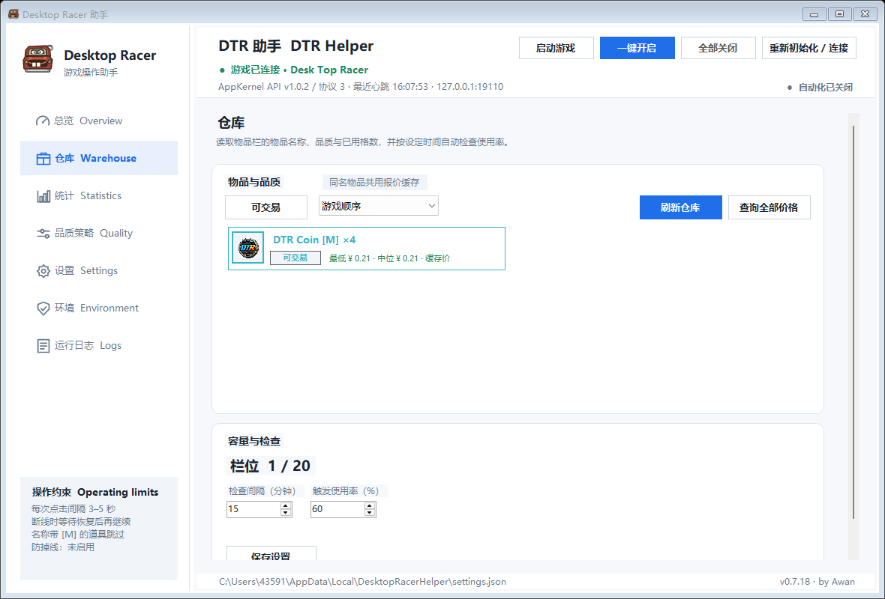
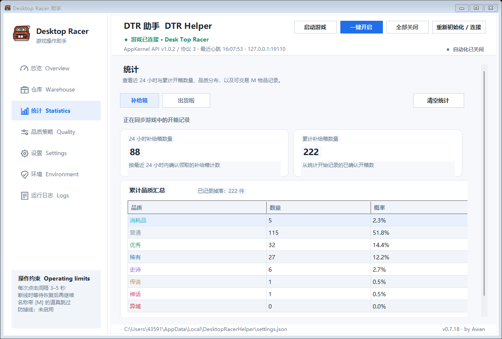
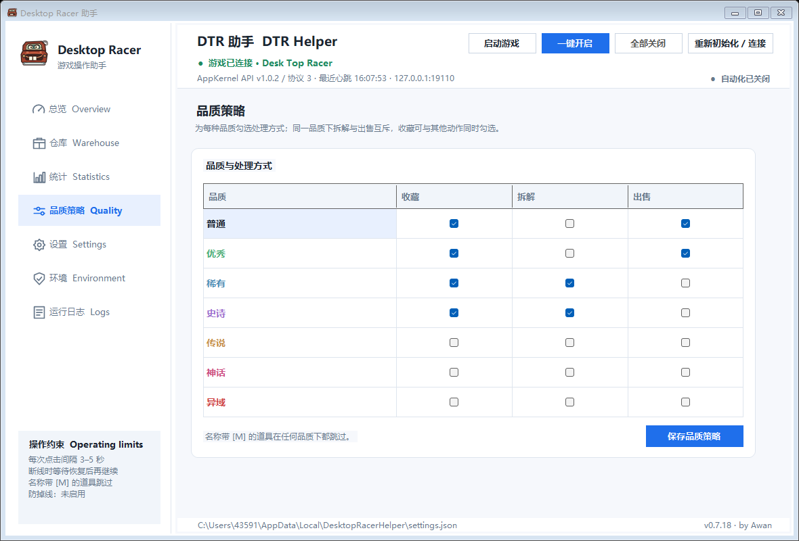
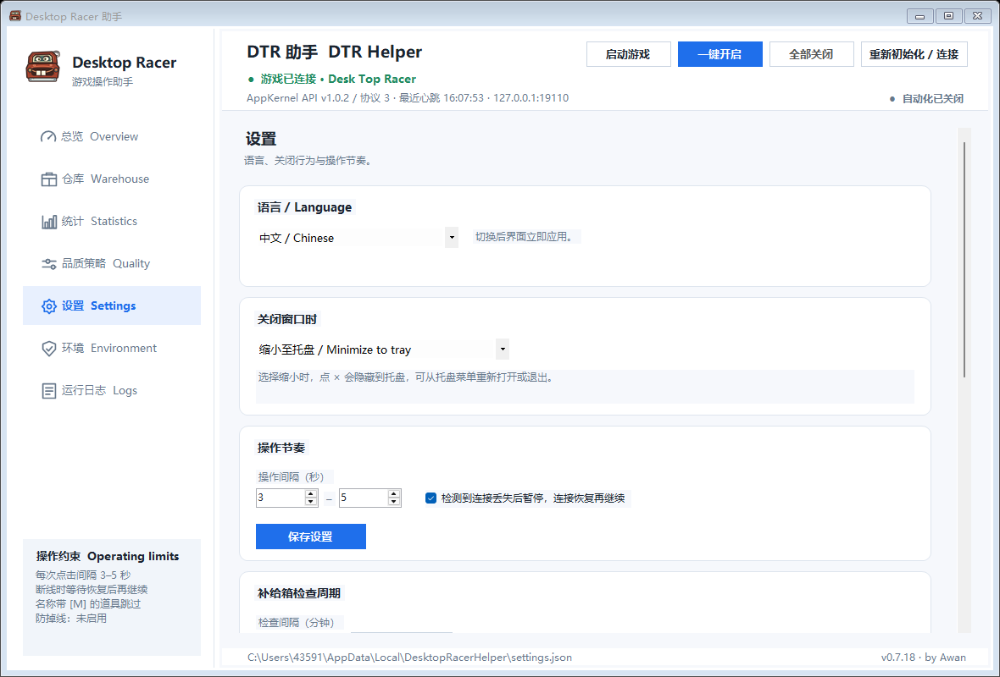
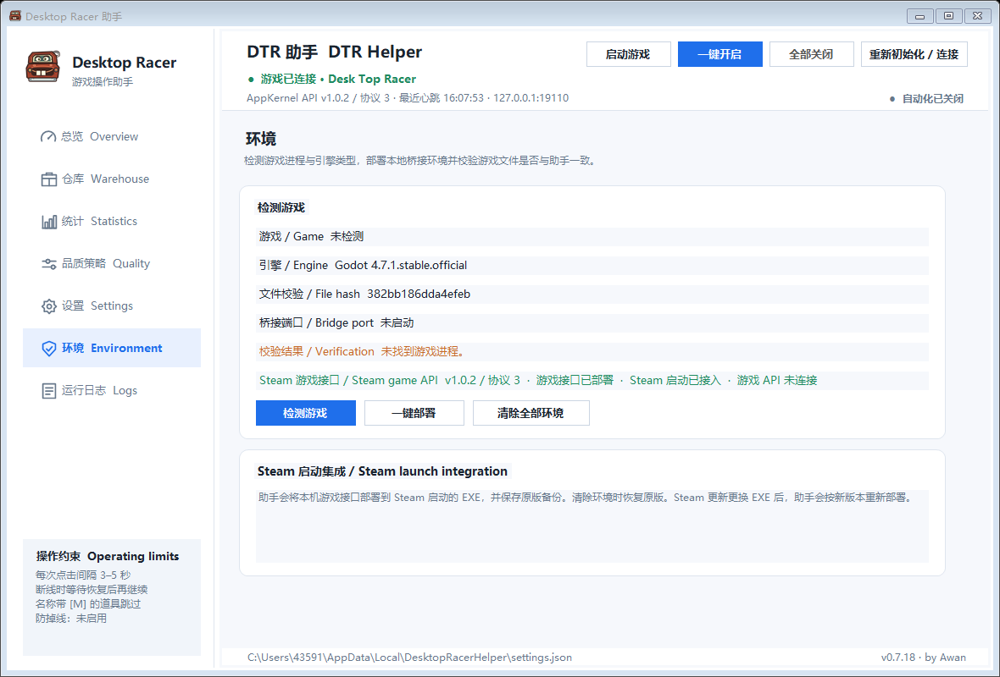

<p align="center">
  
  <a href="https://github.com/buguniaoOVO/DesktopRacerHelper"></a>
</p>

# DTR 助手 · by Awan

Desk Top Racer 的 Windows 桌面助手。助手在本机通过游戏内接口检查并领取补给箱、整理仓库、按品质策略处理物品，并显示道具图片、Steam 市场参考价和掉落统计。

**[下载 v0.7.18](https://github.com/buguniaoOVO/DesktopRacerHelper/releases/latest)** · [首次使用说明](#首次使用) · [问题反馈](https://github.com/buguniaoOVO/DesktopRacerHelper/issues)



## 首次使用

1. 在 Steam 安装 Desk Top Racer，并至少启动过一次。
2. 从下载页获取 `DesktopRacerHelper-v0.7.18-win-x64.zip`，完整解压到当前 Windows 用户可写的目录。`Assets` 目录需要和 EXE 放在一起，不要单独移动。
3. **务必先打开 `DesktopRacerHelper.exe`，让助手完成初始化，等待环境两项都安装完成。** 打开后助手会自动校验游戏文件并安装两项环境：跟随发布包的程序与接口环境，以及内置的 Godot 补丁工具 GDRE v2.7.0。两项都装好后，环境页的“校验结果”显示通过、“Steam 游戏接口”显示已部署。这一过程只在本机进行，不需要联网。
4. 首次打开时如果助手还没识别到游戏目录，在“设置”页选择这台电脑上的 `Desk Top Racer.exe`，再回到“环境”页点一次“一键部署”。
5. 环境两项都完成后，从 Steam 启动游戏，等助手顶部显示“游戏已连接”，再点“一键开启”。

环境部署过之后不需要每次重新安装：助手启动时会核对部署记录和文件指纹，校验通过就直接复用。只有游戏更新更换了 EXE、或换了电脑时，才需要再部署一次。

## 功能

| 页面 | 功能 |
| --- | --- |
| 总览 | 游戏连接状态；一键开启持续检查补给箱与仓库，也可立即执行单项检查 |
| 仓库 | 读取储物箱道具，图片展示、重复合并、名称搜索、品质与类型筛选、按参考价排序 |
| 统计 | 补给箱开箱记录、24 小时与累计数量、品质分布、可交易道具记录 |
| 品质策略 | 收藏、拆解、出售的品质规则；仓库使用率达到阈值后开始整理 |
| 设置 | 检查周期、共用间隔、领取后立即整理、防掉线开关与检测间隔 |
| 环境 | 一键部署游戏接口，保存原版备份，可校验并恢复 |
| 运行日志 | 逐条带时间的运行记录与保留时间设置 |







## 工作原理

助手把接口脚本部署到 Steam 启动的游戏 EXE 内，并在游戏目录保存原版备份；游戏运行期间无法替换 EXE，退出后助手完成接入。接口启动后助手按当前游戏进程 PID 探测 `127.0.0.1:19110–19120`，连接后通过回环地址调用游戏内部入口执行动作，界面负责显示状态与保存设置。

价格查询使用 Steam 市场公开报价，并按配置的货币换算；参考估值不等于可提现金额，助手不执行市场挂单或交易。

## 源码与构建

WinForms 助手源码位于 `DesktopRacerHelper/`，游戏侧接口脚本位于 `Assets/game-plugin/`，内置补丁工具位于 `Assets/tools/`。

```powershell
dotnet publish DesktopRacerHelper.csproj -c Release -r win-x64 --self-contained true `
  -p:UseAppHost=true -p:PublishSingleFile=true `
  -p:IncludeNativeLibrariesForSelfExtract=true -p:DebugSymbols=false -p:DebugType=None
```

需要 .NET 10 SDK。本仓库不包含游戏本体、生成的接口文件、个人配置、统计记录或完整游戏日志。源码来源与许可范围见 [NOTICE](NOTICE.md)。

## 支持作者

可以扫描页首的发电图支持阿丸好饿，也可以给仓库点 Star。问题反馈请带上助手版本、游戏版本和发生时间。

自动化操作可能受到游戏或平台规则限制，请先阅读相关规则并自行评估账号风险。

**by Awan**
