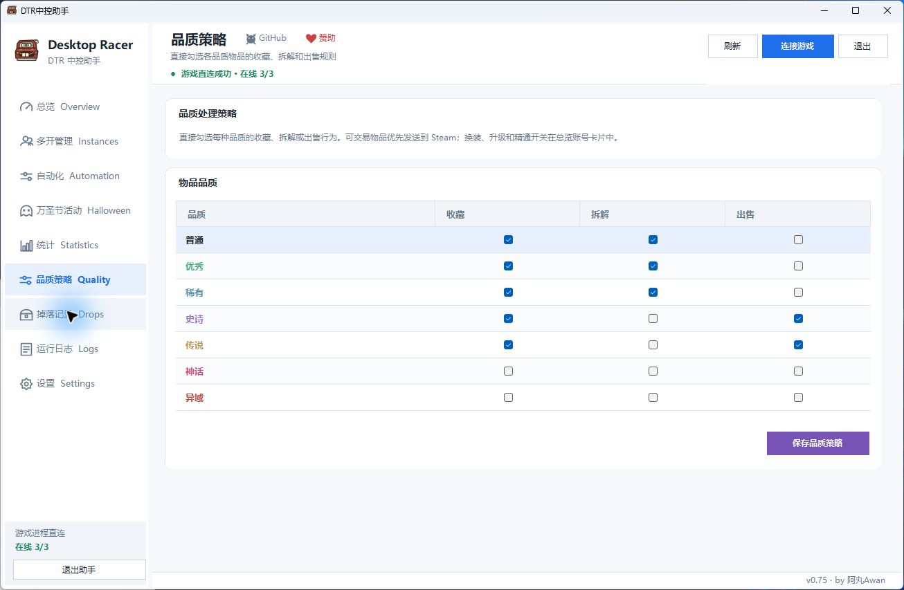
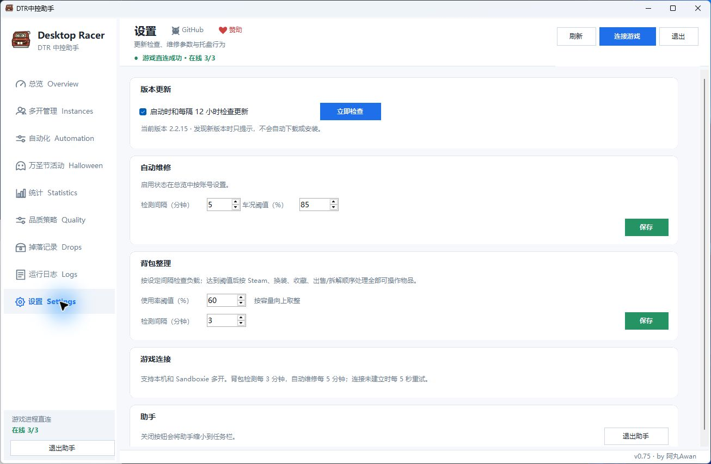

  
  

# DTR 中控助手 v0.75

Windows x64 桌面助手，用于管理《Desktop Racer》多账号游戏进程和自动化任务。

[下载 v0.75](https://github.com/buguniaoOVO/DesktopRacerHelper/releases/tag/v0.75)

## 更新与使用

本次版本用于覆盖更新。下载 EXE 后，退出助手，将文件改名为 `DTR中控助手.exe` 并覆盖到原安装目录，保留原有 `Assets` 文件夹。启动助手，再通过 Steam 或 Sandboxie 启动游戏；账号状态显示在线后，在总览按账号勾选所需任务。

## 连接与功能

助手按 PID 匹配游戏账号，优先接入 `127.0.0.1:19110–19120` 的本机游戏接口。本机接口不可用时，尝试游戏 HTTPS 接口。助手支持多进程和 Sandboxie。

总览提供开箱、背包整理、Steam 转移、自动换装、自动维修等开关。背包检测默认每 3 分钟，维修检测默认每 5 分钟；背包达到设置阈值后，按 Steam 转移、换装、收藏、拆解/出售顺序整理。

当前游戏接口 1.0.2 暂不支持自动升级装备，该功能需要接口 1.0.3。

## 界面截图

### 品质策略

### 检测设置

自动化操作可能受到游戏或平台规则限制，请阅读相关规则并自行评估账号风险。

**by 阿丸Awan**
